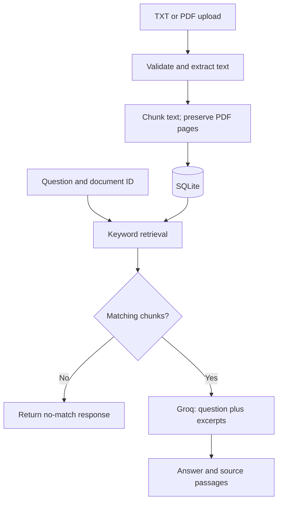

# DocuMind — Document Question Answering

Upload a TXT or text-based PDF, ask a question, and inspect the passages used to generate the answer. DocuMind combines a FastAPI backend, a lightweight browser interface, SQLite storage, keyword retrieval, and Groq-hosted generation.

**[Live demo](https://documind-vc21.onrender.com/)** · **[Interactive API docs](https://documind-vc21.onrender.com/docs)** · **[GitHub repository](https://github.com/SajidurCodes/DocuMind)**

> Uploaded documents are temporary on Render. They can disappear when the service restarts, redeploys, or sleeps. The first request after inactivity can take about a minute. Use non-sensitive sample documents: retrieved passages are sent to Groq for answer generation.

## What it does

- Accepts UTF-8 TXT and text-based PDF files up to **1 MiB**; PDFs are limited to **50 pages**.
- Extracts PDF text while retaining original PDF page positions.
- Splits text into overlapping character windows: **800 characters**, with **120 characters of overlap** by default.
- Chunks each PDF page separately so chunks do not cross page boundaries.
- Stores documents and chunk metadata in SQLite under generated document IDs.
- Retrieves up to three chunks using distinct keyword overlap with the question.
- Generates answers through Groq using `openai/gpt-oss-20b`.
- Returns numbered source references, source text, and PDF page numbers.
- Provides a charcoal-themed browser interface with loading states, validation messages, and expandable source passages.
- Includes 13 local regression tests that avoid live Groq calls.

## How it works

Uploading validates the document, extracts its text, creates chunks, and stores those chunks with their metadata. Asking a document question loads that document, ranks its chunks, and sends the selected passages with the question to Groq.



The retrieval score is the number of distinct words shared by a question and a chunk. Ties are resolved by original chunk order. Scores are not confidence estimates. If no words match, the application returns a fixed no-match response without calling Groq.

When passages are retrieved, the prompt asks the model to answer only from those passages, cite excerpt numbers, and acknowledge missing information. This is a prompt-based instruction, not a guarantee of factual correctness.

## Technology

| Component | Implementation |
|---|---|
| Backend | Python 3.11, FastAPI, Uvicorn |
| Validation | Pydantic |
| PDF extraction | pypdf |
| Storage | SQLite through Python's `sqlite3` module |
| Retrieval | Custom keyword-overlap ranking |
| Generation | Groq Python SDK; `openai/gpt-oss-20b` |
| Interface | HTML, CSS, vanilla JavaScript |
| Configuration | Environment variables and python-dotenv |
| Tests | pytest and FastAPI TestClient |
| Hosting | Render Free web service |

## Run locally on Windows

### Requirements

- Python 3.11 and Git
- A Groq API key with access to the configured model
- Internet access for package installation and model requests

Run the following in **Command Prompt**:

```bat
git clone https://github.com/SajidurCodes/DocuMind.git
cd DocuMind
python -m venv .venv
.venv\Scripts\activate.bat
python -m pip install -r requirements.txt
copy .env.example .env
```

Open `.env` and set:

```dotenv
GROQ_API_KEY=your_actual_groq_key
```

Do not commit `.env`. The example file should contain only an empty value or placeholder.

Start the application:

```bat
python -m uvicorn app.main:app --reload
```

- Browser interface: <http://127.0.0.1:8000/>
- API documentation: <http://127.0.0.1:8000/docs>
- Health endpoint: <http://127.0.0.1:8000/health>

The application creates `data/local/documind.db` at startup. Local documents survive application restarts unless this database is removed. The database folder is ignored by Git.

## Try it

1. Open the browser interface.
2. Upload `data/sample_docs/handbook.txt`, or a small PDF with selectable text.
3. Ask a complete question such as: **How many days of annual leave do employees receive?**
4. Expand **Source passages** and compare the answer with its evidence.
5. Ask about information absent from the document to inspect the refusal behaviour.

The sample handbook states that annual leave is 18 days. A two-page PDF was also manually tested during development: its expense policy states 14 days on PDF page 2. That PDF is not required by the automated test suite.

Questions are independent: displayed answer history is not sent to the model. Refreshing the page clears the browser's active-document selection and displayed history. Uploading a new document switches the active document and clears the displayed answers.

## API endpoints

| Method | Path | Purpose |
|---|---|---|
| GET | `/` | Browser interface |
| GET | `/health` | Application liveness; returns `{"status":"ok"}` |
| POST | `/chat` | General model answer without document retrieval |
| POST | `/documents/preview` | Validate, extract, and chunk a file without saving |
| POST | `/documents` | Save a document and return its ID and chunks; HTTP 201 |
| GET | `/documents/{document_id}` | Retrieve a stored document |
| POST | `/documents/{document_id}/search` | Return ranked matching chunks without a model call |
| POST | `/documents/{document_id}/ask` | Generate a document-grounded answer with source metadata |

Upload requests use `multipart/form-data` with a field named `file`. Chat, search, and document-answer requests accept:

```json
{
  "question": "Within how many days must expense claims be submitted?"
}
```

Questions are trimmed and must contain between 1 and 2,000 characters. Use `/docs` to upload files and test requests interactively.

Document-answer responses contain `document_id`, `filename`, `answer`, and `sources`. Each source contains:

| Field | Meaning |
|---|---|
| `citation_id` | Excerpt number, starting at 1, used in the prompt |
| `chunk_index` | Original chunk position, starting at 0 |
| `text` | Retrieved passage supplied to the model |
| `page_number` | Original PDF page position, starting at 1; `null` for TXT |

Citation IDs are not PDF page numbers. PDF page positions may also differ from printed page labels. The sources list records all retrieved passages supplied to the model; it does not automatically verify every claim or indicate that every source was cited.

Common responses include 404 for an unknown document, 413 for a file exceeding the processing limit, 415 for an unsupported extension, and 422 for invalid input. Model connectivity, configuration, and quota problems return 503; other handled model failures return 502.

## Tests

Install development dependencies and run the suite from the repository root:

```bat
python -m pip install -r requirements-dev.txt
python -m pytest -q
```

**Development checkpoint: 13 tests passed locally.** The suite covers chunk overlap, invalid chunk settings, page metadata in retrieval, TXT upload/read behaviour, invalid uploads, missing documents, blank questions, answer-source page preservation, and skipping the model when no chunks match.

API tests use temporary SQLite databases and block real Groq calls. The answer test substitutes a predictable response. These are application regression tests, not a benchmark of model accuracy. Automated PDF parsing coverage and retrieval-quality evaluation remain future work.

GitHub Actions is not configured as part of this version. Tests are run locally.

## Project layout

| Path | Responsibility |
|---|---|
| `app/main.py` | API routes, schemas, startup, upload processing, and generation |
| `app/storage.py` | SQLite document persistence and legacy chunk compatibility |
| `app/rag/models.py` | Shared chunk model with optional page metadata |
| `app/rag/chunking.py` | Character-based chunk splitting |
| `app/rag/pdf_loader.py` | PDF page extraction and page-aware chunking |
| `app/rag/retrieval.py` | Keyword ranking and retrieved-chunk metadata |
| `app/static/index.html` | Browser layout, charcoal theme, and API interaction |
| `scripts/check_groq.py` | Manual live Groq connection check |
| `tests/test_app.py` | Regression tests |
| `data/sample_docs/` | Small text fixtures |
| `data/local/` | Ignored local database and local test files |
| `.env.example` | Configuration template |
| `.python-version` | Python version family for Render |
| `requirements.txt` | Application dependency snapshot |
| `requirements-dev.txt` | Application dependencies plus test tools |


## Author

Built by [Sajidur Rahman Siam](https://github.com/SajidurCodes) as hobby project.


